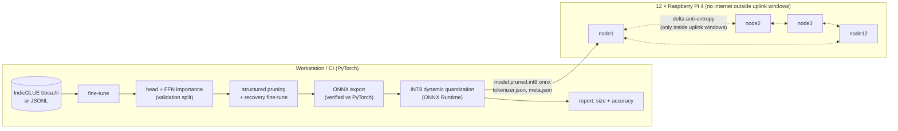
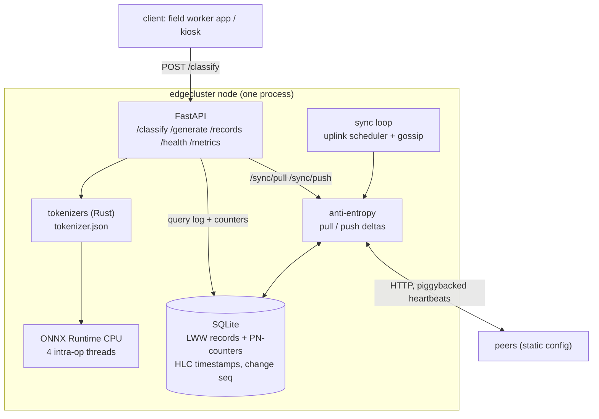

# offline-edge-inference-cluster

An offline-first distributed inference system for a cluster of Raspberry Pi 4
nodes that are only connected to each other and to the internet during short
**uplink windows** (about two hours a day). It serves multilingual
(Hindi / Urdu / Dogri) intent classification of welfare-scheme queries, and
optionally a small generative model. Nodes keep working fully offline and
reconcile their data with CRDTs when a window opens.

This repository is a **rebuild** of *Nida-e-Watan*, a digital-inclusion
project that helped displaced families in the Chenab Valley (Jammu & Kashmir)
find and access government welfare schemes such as pensions, ration cards,
housing, health cover, scholarships and identity documents. The project's
original code and data were lost in 2026. Everything here was rewritten from
scratch, and every number in this README was produced by running this code.

**Contents:** [Problem](#problem) · [Architecture](#architecture) · [Quickstart](#quickstart) ·
[Data](#data) · [Compression](#compression) · [Serving](#serving) · [Sync](#sync) ·
[Results](#results) · [Repository layout](#repository-layout) · [Limitations](#limitations)

## Problem

* **Hardware:** 12 × Raspberry Pi 4 (4 GB RAM, 4× Cortex-A72, no GPU, no RTC),
  one per site (camps, panchayat offices, schools).
* **Connectivity:** no reliable internet. Sites can reach each other (and the
  internet) only inside a scheduled window of roughly two hours a day, over
  links that drop packets.
* **Workload:** short queries typed or transcribed in Hindi, Urdu or Dogri,
  such as "my old-age pension hasn't come for three months" or "how do I get
  a duplicate ration card", have to be routed to the right scheme category.
  The answer is needed immediately, not at the next uplink window.
* **Data:** query logs and case records (which family needs which document,
  application status) are created at every site and must eventually agree
  everywhere, with no central server and no lost updates.

That gives three pillars: (1) shrink a multilingual transformer until it
runs well on a Pi, (2) serve it locally with ONNX Runtime, (3) replicate
state with CRDTs and anti-entropy that tolerate partitions, message loss and
reboots.

## Architecture



Inside one node:



## Quickstart

Requires Python 3.10+ (3.11 recommended, the Raspberry Pi OS Bookworm default).

```bash
git clone https://github.com/aryavsparihar/offline-edge-inference-cluster.git
cd offline-edge-inference-cluster
make install          # .venv with pinned training + serving + test deps
```

**1. Run the tests** (CRDT property tests, store, protocol, API, a real 3-node
HTTP cluster, pruning on tiny encoders, and the full compression pipeline on
a tiny Hub model):

```bash
make test
```

**2. Compress a model.** The fast smoke version uses a tiny random BERT on the
demo sample and finishes in about a minute on CPU:

```bash
make compress-tiny
```

The real run fine-tunes XLM-R base on IndicGLUE `bbca.hi`, prunes it, quantizes
it and prints the size/accuracy report. It downloads about 1.1 GB, and a GPU or
Apple-silicon MPS helps:

```bash
make compress                                        # configs/compress/xlmr-bbca.yaml
make compress CONFIG=configs/compress/mbert-bbca.yaml
```

**3. Start a 3-node local cluster and watch it converge after a partition.**
These are real HTTP node processes with a compressed uplink schedule (a 12 s
window every 20 s):

```bash
make cluster-demo
```

**4. Simulate the 12-node deployment** with partitions, message loss and
restarts:

```bash
make sim      # one run, default fault settings, per-window table
make sweep    # full grid over loss / partition length / rounds / restarts
```

**5. docker-compose, 12 nodes by default:**

```bash
make cluster-up NODES=12      # builds the image, starts node1..node12 on :8001..:8012, waits for convergence
make cluster-down
```

**6. Serve one node with a compressed model:**

```bash
make serve NODE_CONFIG=configs/node.local.yaml
curl -s -X POST localhost:8000/classify -H 'content-type: application/json' \
     -d '{"text": "राशन कार्ड खो गया है, डुप्लीकेट कैसे मिलेगा", "lang": "hi"}'
```

**7. Benchmark on a Raspberry Pi:** see [deploy/raspberry-pi.md](deploy/raspberry-pi.md).

```bash
make bench MODEL_DIR=runs/xlmr-bbca/onnx RUN=runs/xlmr-bbca
```

## Data

**The original regional-language corpus is not included in this repository.
The project's original code and data were lost in 2026, and this repository
is a rebuild of the system.** To run it, use either:

* the **hand-made demo sample** in [`data/sample/`](data/sample/): 42 Hindi and
  42 Urdu queries written for this rebuild (6 per intent), plus 7 Dogri
  placeholder drafts marked `# TODO: native-speaker review` that the pipeline
  skips until reviewed. These are demo examples, not original data and not
  real user queries. They are enough to exercise every component, not to
  train a useful model.
* the **public-dataset loader** for AI4Bharat's IndicGLUE
  (`python -m edgecluster.data.public --config bbca.hi`), which gives the
  pipeline real Indic-language training and test data. `bbca.hi` is Hindi
  news-topic classification, used as a proxy task for measuring compression.
  It is not the welfare-intent task.

Format, label set and dataset caveats: [data/README.md](data/README.md).

## Compression

`edgecluster/compression/`, driven by `python -m edgecluster.compression.pipeline --config ...`:

| stage | module | notes |
|---|---|---|
| fine-tune | `finetune.py` | plain PyTorch loop (AdamW, linear warmup/decay); best checkpoint chosen on the validation split |
| head importance | `pruning.py` | Michel et al. 2019: gradient of the loss w.r.t. a per-head gate (forward pre-hook on the attention output projection), L2-normalised per layer, global ranking |
| FFN importance | `pruning.py` | first-order Taylor score \|a·∂L/∂a\| per intermediate neuron |
| pruning | `pruning.py` | heads via `model.prune_heads` when the installed `transformers` has it, otherwise by slicing Q/K/V/O directly. FFN neurons by slicing the up/down projections |
| recovery | `finetune.py` | short fine-tune of the pruned model |
| export | `export.py` | `torch.onnx.export` (opset 17, dynamic batch/sequence axes). ORT logits are checked against PyTorch on validation texts |
| INT8 | `quantize.py` | `onnxruntime.quantization.quantize_dynamic` after `quant_pre_process`. `MatMul` + `Gather` (embeddings), per-tensor by default, per-channel optional |
| report | `report.py` | size on disk and test accuracy for fp32, fp32+INT8, pruned and pruned+INT8 |

**Model support:**

* `xlm-roberta-base` (278M parameters, 1.11 GB fp32 ONNX) matches the original
  project's 1.1 GB figure. 69% of its parameters are the 250k-token
  embedding matrix, which head/FFN pruning can't touch but INT8 `Gather`
  quantization does.
* `bert-base-multilingual-cased` (178M parameters, 0.71 GB fp32 ONNX) is
  smaller, so the 1.1 GB → 260 MB target doesn't apply to it.
* `ai4bharat/indic-bert` is ALBERT. **Per-layer head pruning is not
  meaningful for ALBERT**: all 12 layers share a single attention block, so
  removing head *h* removes it from every layer at once. The pruning code
  supports this. It scores heads over all 12 applications of the shared block
  and prunes the shared block, and the offline tests cover it on a tiny ALBERT.
  The real `ai4bharat/indic-bert` checkpoint is **gated** on the Hub (you must
  accept its terms and log in), so it was not run for this README. Use
  `configs/compress/indicbert-bbca.yaml` after `huggingface-cli login`.

## Serving

`edgecluster/serving/` is a FastAPI app with one ONNX Runtime session and a
Rust `tokenizers` tokenizer. There is no torch or transformers on the Pi.

| endpoint | purpose |
|---|---|
| `POST /classify` | `{"text", "lang"}` → label, confidence, per-label scores, tokenize/inference/total ms. Also writes a replicated query-log record (label, language, node, SHA-256 of the text, but **not** the raw text unless `store_query_text: true`) and bumps a per-label PN-counter |
| `POST /generate` | only if `generator.enabled`: Qwen2.5-0.5B-Instruct (INT8 ONNX) with a hand-written KV-cache greedy decoder |
| `GET /health`, `GET /metrics` | Prometheus histograms for classify / inference / generate latency, sync counters, records, RSS |
| `POST/GET/DELETE /records/{cases,queries}` | the replicated record store |
| `POST /sync/pull`, `POST /sync/push`, `GET /sync/digest`, `GET /cluster` | the anti-entropy protocol and cluster view |
| `POST /admin/links`, `POST /admin/sync-now` | only with `admin_enabled`: emulate a link failure, force a round (demos/tests) |

Thread settings for a 4-core Pi: `intra_op_num_threads=4`,
`inter_op_num_threads=1`, sequential execution, `ORT_ENABLE_ALL` graph
optimizations, inference calls serialized by a lock so concurrent requests
queue instead of oversubscribing the cores.

**Generative model:** Qwen2.5-0.5B-Instruct (494M params, Apache-2.0), using
the INT8 ONNX export published at `onnx-community/Qwen2.5-0.5B-Instruct`
(`onnx/model_quantized.onnx`, 512 MB on disk). Larger models (1.5B+) don't
leave room for the classifier and OS on a 4 GB Pi. The decoder is plain numpy
around `session.run`. Memory use and latency are in [Results](#results).

## Sync

`edgecluster/sync/` (everything below is implemented from scratch):

* **Hybrid logical clocks** (`hlc.py`): timestamps `(wall_ms, logical, node_id)`.
  They stay monotonic when an RTC-less Pi's wall clock jumps backwards, and the
  clock state is persisted so they survive reboots.
* **CRDTs** (`crdt/`): `GCounter`, `PNCounter`, `LWWRegister` (HLC-ordered),
  `ORSet` (add-wins, observed-remove) and `LWWMap` (per-key LWW registers with
  tombstones). Hypothesis property tests check that every merge is
  commutative, associative and idempotent, that merge is an upper bound, and
  that merge order doesn't matter (`tests/test_crdt_properties.py`).
* **Replicated store** (`store.py`): SQLite (WAL). Each `(collection, key)`
  is an LWW register and each counter is stored as per-node PN slots. Every
  change gets a node-local sequence number and remembers which peer it came
  from.
* **Anti-entropy** (`antientropy.py`): delta-based push-pull. A pulls B's
  changes after its cursor and B's changes from A are never echoed back. A then
  pushes its own unacknowledged changes. Cursors only advance after a
  successful merge, so a lost response just means a resend, which is
  idempotent. Requests are paginated and retried with a bound. If a peer's
  database is wiped, its new `store_id` resets the cursors and triggers a
  full resend.

`edgecluster/cluster/`:

* **static peer config** (`config.py`, one YAML shared by all nodes),
* **gossip** (`gossip.py`): heartbeat maps merged by per-node max,
  piggybacked on pull requests/responses. Peer selection prefers live peers
  and still probes suspected ones, since in this deployment silence usually
  means a closed window rather than a dead node,
* **uplink-window scheduler** (`scheduler.py`): repeating windows in local
  time (e.g. `06:00` + `2h`, IST), with real, compressed (`time_scale`) or
  manual clocks so the same code runs in production, demos and the simulator.

## Results

RESULTS_PLACEHOLDER

## Repository layout

```
edgecluster/
  compression/   finetune, pruning (importance + heads + FFN), export, quantize, evaluate, report, pipeline
  serving/       FastAPI app, ONNX classifier, ONNX generator, ORT session tuning, Prometheus metrics
  sync/          hlc, crdt/ (GCounter, PNCounter, LWWRegister, ORSet, LWWMap), SQLite store, anti-entropy
  cluster/       uplink scheduler, gossip membership, HTTP transport, SyncNode runtime
  data/          JSONL schema, IndicGLUE loader
  config.py      YAML + EDGE_* env configuration
sim/             in-process simulator, sweep, localhost cluster demo, docker-compose generator + watcher
bench/           continuous-load latency benchmark (run on the Pi)
deploy/          Raspberry Pi guide, systemd unit, install script, multi-arch Dockerfile
configs/         compression configs, cluster/node examples
data/            format docs, hand-made demo sample
tests/           pytest + Hypothesis
results/         outputs of the runs quoted in this README
```

## Limitations

* No Raspberry Pi was available while building this rebuild, so **edge latency
  and memory are not reported here**. `make bench` prints them in the target
  table format for pasting into this README.
* `bbca.hi` is a stand-in task (Hindi news topics). Accuracy on the real
  welfare-intent task, and on Urdu and Dogri, needs real labeled queries.
* The sync layer trusts its peers: there is no authentication or encryption
  on the sync endpoints. Run it on a private network or VPN (e.g. WireGuard)
  between sites.
* LWW resolves concurrent edits to the same case record by HLC order, so one
  edit wins and the other is overwritten (it is not merged field by field).
  That is acceptable for status fields but not for free-text notes.
* Tombstones are kept forever. There is no garbage collection yet.

## License

Apache-2.0
